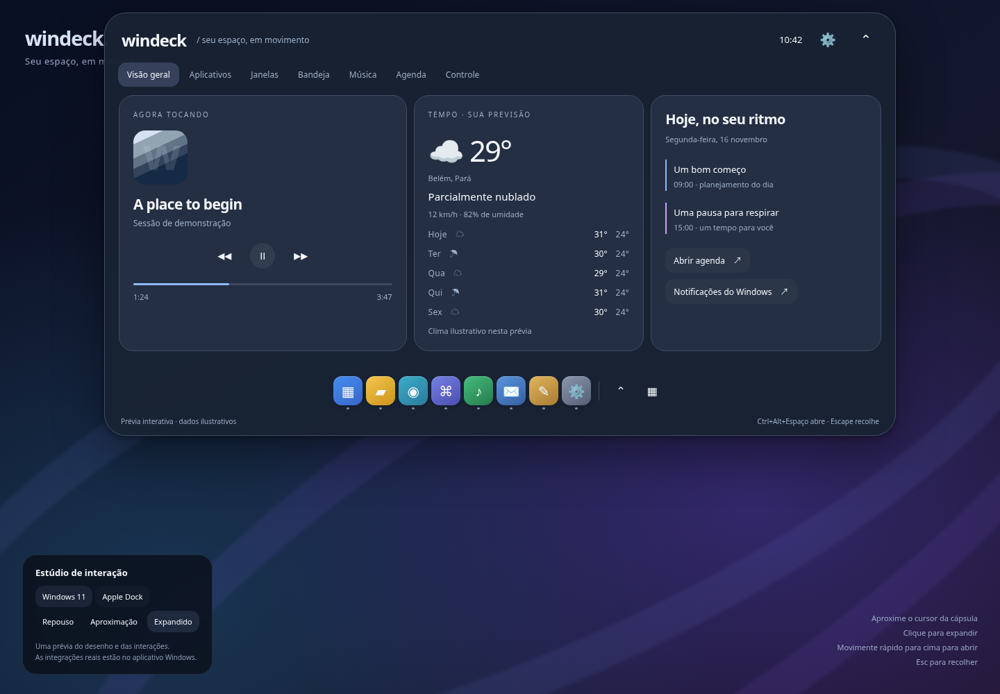

# Windeck

Uma barra dinâmica no centro superior da tela. Aproximação revela os olhos;
clique ou um gesto rápido para cima abre o espaço de trabalho. Dois temas:
**Fluent**, inspirado no Windows 11, e **Dock**, com cápsula escura e ampliação dos ícones.

[](https://github.com/vazlucase/windeck/actions/workflows/windows.yml)



**Estado: alpha 0.1.0.** Há um aplicativo Windows compilado, serviços reais de
janelas e bandeja, e uma prévia interativa dos layouts. Esta entrega não é uma
substituição com paridade de 100% já homologada. As integrações precisam de
execução e validação em Windows; o ambiente de desenvolvimento desta entrega
é Linux. Consulte [a matriz de paridade](docs/PARIDADE.md) antes de tratar o
Windeck como substituto definitivo.

## Executar

Baixe **Windeck-windows-x64.zip** na [release alpha](https://github.com/vazlucase/windeck/releases/tag/v0.1.0-alpha.1).
O pacote destina-se ao **Windows 11 x64**. Não exige instalação separada do .NET.

1. Extraia a pasta do pacote Windows x64 e execute **Windeck.exe**.
2. A cápsula aparece no topo de cada monitor. Aproxime, clique ou movimente o
   cursor rapidamente para cima em direção ao centro dela.
3. A substituição da barra é ativada após a inicialização da bandeja e do
   processo de recuperação. O Explorer continua fornecendo a área de trabalho.
4. Para manter a barra original enquanto conhece o Windeck, use **Previa.cmd**
   ou `Windeck.exe --preview`.

O executável é autocontido: o pacote inclui o runtime .NET. O aplicativo roda
sem privilégios de administrador. O binário desta entrega não tem assinatura
de código; sua organização ou o Windows podem exigir validação antes da execução.
Não é necessário desativar proteções do sistema.

## Interação

| Ação | Resultado |
| --- | --- |
| Aproximar o cursor por 140 ms | Revela os olhos e uma informação de contexto. |
| Mover o cursor para longe | Recolhe a aproximação após 450 ms. |
| Clicar na cápsula | Abre o painel completo. |
| Movimento rápido e direcionado para cima | Expande diretamente, com sensibilidade configurável. |
| Escape ou clique fora | Recolhe o painel. |
| Ctrl+Alt+Espaço | Abre/recolhe no monitor do cursor. |
| Ctrl+Alt+Backspace | Restaura a barra do Windows. |
| Clique em aplicativo aberto | Ativa/restaura; minimiza se ele era o aplicativo ativo. |
| Clique em grupo de janelas | Escolhe uma janela do grupo. |
| Botão direito em aplicativo | Ações de janela, fixação e documentos recentes disponíveis. |
| Botão do meio / Shift+clique | Abre outra instância, quando o aplicativo permite. |
| Shift+botão do meio | Fecha a janela. |
| Alt+arrastar um fixado | Reordena os fixados que estão no modo de atalho. |
| Arrastar arquivo para um app | Abre o arquivo nesse aplicativo; hover ativa janelas abertas. |
| Botão direito na bandeja | Encaminha ao menu do próprio aplicativo. |
| Shift+botão direito na bandeja | Fixa/desafixa o ícone no Windeck. |

## Recuperação

Fechar o Windeck restaura a barra original e remove a reserva de espaço.
Um segundo processo do próprio executável acompanha a sessão. Se a interface
ficar sem responder por 15 segundos, ele revela o Explorer, encerra somente o
processo pai do próprio Windeck e restaura o estado anterior da barra. Na próxima
inicialização, a substituição permanece desativada até ser ativada novamente.
Esse procedimento foi revisado em código; os cenários de falha ainda precisam
ser ensaiados em Windows.

Alternativas disponíveis:

- Execute **Restaurar-barra.cmd**.
- Execute `Windeck.exe --restore`.
- Use **Restaurar barra original** nas configurações do aplicativo.

O Windeck não altera o shell de login nem encerra o Explorer. O início com o
Windows é opcional, no menu de configurações. Para remover o aplicativo,
desative esse início automático, encerre o Windeck e exclua sua pasta.

## Telas

- Visão geral: música, previsão e agenda local.
- Aplicativos: catálogo real, busca por nome e arquivos indexados pelo Windows.
- Janelas: aplicativos abertos, ações de janela e acesso às áreas de trabalho.
- Bandeja: ícones fixados e outros ícones, com os callbacks reais dos aplicativos.
- Música: sessão de mídia do Windows, capa, controles e progresso.
- Agenda: calendário e lembretes locais persistentes.
- Controle: volume real, energia, conexões e acesso aos painéis do Windows.
- Configurações: temas, gestos, animações, substituição, clima e inicialização.

A [prévia interativa](design/preview.html) e o [painel de layouts](design/board.html)
mostram o desenho. Seus dados são ilustrativos e os botões não controlam o
Windows. São artefatos de design separados do aplicativo nativo.

## Dados e privacidade

Preferências, fixados, lembretes e logs ficam em `%LOCALAPPDATA%\Windeck`.
O catálogo de aplicativos e janelas usa os serviços locais do Windows.
O serviço de clima consulta o nome da cidade e as coordenadas retornadas pelo
**Open-Meteo**. A cidade inicial é **Belém, Pará, Brasil**. Não há detecção
silenciosa de localização, telemetria ou conexão com contas de música.

Notificações modernas são abertas na central oficial do Windows. O Windeck
não lê silenciosamente mensagens de outros aplicativos. Notificações clássicas
da bandeja e lembretes locais podem aparecer nos banners próprios, respeitando
`SHQueryUserNotificationState`.

## Compilar

Requisitos: SDK .NET 10 e acesso ao NuGet. Em Windows:

```powershell
.\Build.ps1
.\Package.ps1 -NoBuild
```

Ou:

```powershell
dotnet run --project tests/Windeck.Checks -c Release
dotnet publish src/Windeck.App -c Release -r win-x64 --self-contained true -p:PublishSingleFile=true -p:IncludeNativeLibrariesForSelfExtract=true -p:EnableCompressionInSingleFile=true -o artifacts/windows-x64
```

A compilação cruzada em Linux requer `EnableWindowsTargeting=true`, já definido
no projeto. O resultado é um executável Windows x64; não roda no Linux.

O workflow `Windows` também compila, executa os testes e verifica a construção
e renderização dos oito painéis WPF nos dois temas. As capturas ficam no
artefato `native-layout-verification`. Essa verificação roda sem ativar a
substituição; não certifica os callbacks da bandeja ou os gestos na sessão do usuário.

## Verificação desta entrega

- Build Release Windows: sem erros e sem avisos.
- 17 verificações executadas do núcleo de gestos, molas e persistência.
- Prévia de oito layouts e dois temas testada com Chromium/Playwright.
- Interações da prévia e larguras 1440, 1024, 768 e 390 verificadas.
- APIs nativas, recuperação, bandeja, múltiplos monitores e acessibilidade:
  código presente, execução em Windows pendente.

Veja [arquitetura](docs/ARQUITETURA.md), [plano de validação](docs/VALIDACAO-WINDOWS.md)
e [fontes da pesquisa](docs/PESQUISA.md).

## Créditos

A integração com tarefas e bandeja utiliza **ManagedShell 0.0.374**, sob
Apache-2.0. Os dados meteorológicos são fornecidos pelo **Open-Meteo**, CC BY 4.0.
O código próprio do Windeck é disponibilizado sob MIT. Veja `LICENSE` e `THIRD-PARTY`.
