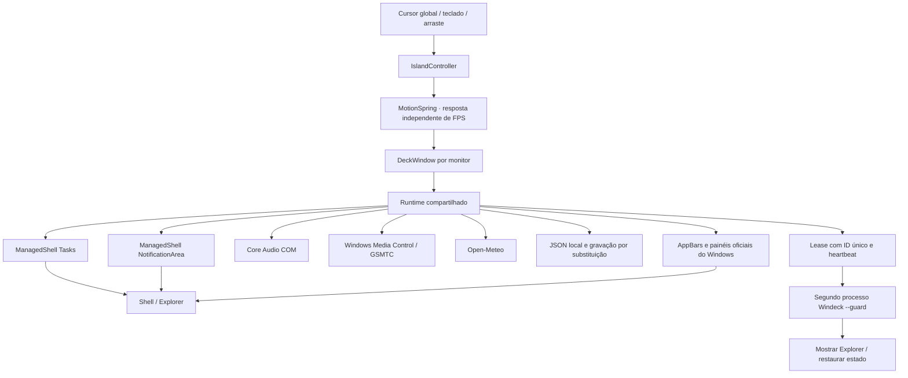

# Arquitetura do Windeck

## Plataforma

Aplicativo C#/.NET 10 com WPF. A interface do executável usa controles Windows,
composição WPF, Win32 e WinRT. O HTML de `design/` é apenas uma prévia para
revisão de layout; não participa da execução do programa.

## Fronteiras

- `Windeck.Core`: estados, detecção de gesto, molas e preferências. Executável em
  Linux para testes sem simular chamadas Win32.
- `Windeck.App`: janelas WPF, serviços de sistema, menus e ciclo de vida.
- `ManagedShell`: gerenciamento real de tarefas, identificação de aplicativos,
  estado/ícones de janelas e protocolo da bandeja.
- `design/`: oito telas, dois temas e controles de interação. Dados ilustrativos..press
- `tests/Windeck.Checks`: verificações do núcleo sem dependência da GUI Windows.

## Estados e dimensões

| Estado | Tamanho em DIPs | Conteúdo | Entrada |
| --- | --- | --- | --- |
| Repouso | 190 × 40 | Marca e hora local | Aproximação, clique, teclado ou gesto. |
| Aproximação | até 360 × 84 | Olhos e informação de contexto | Clique expande, afastamento recolhe. |
| Expandido | até 1140 × 610 | Navegação, painel e aplicativos | Escape, clique fora ou botão recolhem. |

Os limites se adaptam ao monitor. Coordenadas do cursor são convertidas de
pixels para DIPs pelo WPF. A posição da janela é aplicada com Win32 em pixels.
A máquina de estados exige um deslocamento ascendente, uma velocidade mínima,
um corredor no centro e um cooldown. Movimento horizontal rápido não expande.

A mola usa a solução analítica criticamente amortecida, com delta de tempo
limitado. Redução de movimento troca a interpolação pelo estado final. No tema
Dock, a distância do cursor também altera a escala dos ícones; essa ampliação
fica desativada no modo de redução de movimento.

## Ciclo de vida e recuperação

1. Inicializa o serviço de bandeja e janelas; constrói as cápsulas.
2. Antes de ocultar a barra original, cria uma lease com ID único e inicia o
   segundo processo usando o próprio executável.
3. Só prossegue após a confirmação de prontidão do guardião.
4. O thread de UI grava heartbeat independentemente das consultas de rede.
5. Saída normal restaura o Explorer, remove AppBars e descarta os serviços.
6. Se o processo sair de forma inesperada, o guardião restaura a barra.
7. Se a UI deixar de atualizar o heartbeat por mais de 15 segundos, o guardião
   mostra a barra original antes das chamadas de shell e pode encerrar apenas
   o processo pai cujo caminho corresponde ao próprio Windeck.
8. Uma nova sessão após recuperação mantém a substituição desativada até escolha
   do usuário. IDs de lease evitam que um guardião antigo restaure uma sessão nova.

Essas proteções foram implementadas e revisadas. Falha/crash, encerramento
forçado e restauração de auto-hide precisam de validação real em Windows.

## Monitores e área de trabalho

Uma cápsula é criada em cada monitor conectado. `WM_DISPLAYCHANGE` solicita uma
reconciliação no thread de UI: adiciona, atualiza e retira janelas. A remoção de
um monitor não deve encerrar a aplicação. A opção AppBar reserva 54 DIPs no topo;
um cache evita ciclos de `ABN_POSCHANGED` entre monitores. A detecção de tela
cheia é por retângulo e monitor, com exceção da área de trabalho do Explorer.

## Busca e fixação

O catálogo usa `shell:AppsFolder` e atalhos dos menus Iniciar. Arquivos são
consultados no índice Windows Search; a pesquisa usa texto escapado, limite de
resultados, debounce e rejeição de resultados cancelados. A busca nativa completa
permanece disponível para locais que não estão indexados.

Fixados são armazenados separadamente no Windeck. Atalhos `.lnk` resolvidos podem
ser combinados com grupos de janelas pelo caminho ou AppUserModelID. A importação
dos pins modernos do Windows não é integral nesta alpha.

## APIs e privacidade

Os serviços de mídia controlam sessões já publicadas ao Windows, sem login em
Spotify ou outro provedor. O Core Audio consulta o endpoint padrão. A bandeja
encaminha os cliques para os aplicativos proprietários. O clima é a única
consulta de rede iniciada automaticamente pelo Windeck. Não há coletor de
telemetria ou exportação automática de dados locais.

Notificações modernas continuam na central oficial. Uma inbox redesenhada exige
um desenho de permissões/identidade de aplicativo e APIs próprias; não foi
substituída por dados simulados no executável.
